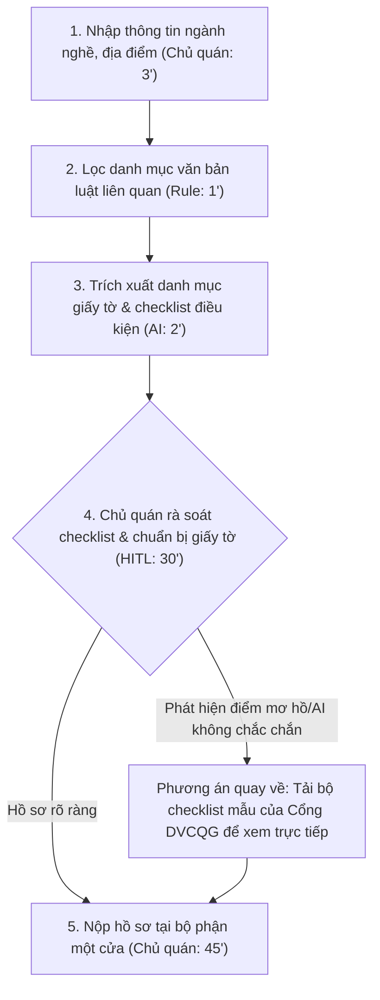

# Báo cáo nhóm — Day 02 Discovery & Problem Framing

> Bản chung của nhóm, viết trên repo do nhóm trưởng fork. Không copy file này sang repo cá nhân.
> Template chi tiết và prompt mẫu: [docs/01-worksheet.md](../../docs/01-worksheet.md). Bài mẫu: [docs/02-deliverable-example.md](../../docs/02-deliverable-example.md).

## 1. Thông tin nhóm

- Tên nhóm: Nhóm L3A-01
- Thành viên: xem `TEAM.md` (Đăng, Đạt, Hùng, Tiến)
- Candidate problem được chọn: Tra cứu quy định pháp lý & thủ tục hành chính cho hộ kinh doanh cá thể.
- Quyết định cuối: **Go** (Pilot phạm vi hẹp cho ngành F&B/quán ăn nhỏ).

---

## 2. Hội tụ nhóm (CP3)

### 2.1. Pitch

| # | Người đưa ra | Candidate (Job Story ngắn) | Actor | Bottleneck | Câu hỏi phản biện nhận được (ai hỏi) |
|---:|---|---|---|---|---|
| 1 | Đăng | Khi làm thủ tục hành chính/thuế/PCCC, tôi muốn tra cứu đúng giấy tờ và điều kiện ngành hàng của mình, để chuẩn bị đúng hồ sơ ngay lần đầu không bị trả về. | Chủ hộ kinh doanh cá thể, chủ quán ăn nhỏ | Đọc 4–5 văn bản thông tư PDF phức tạp (120') và xử lý hồ sơ bị trả về (90') | "Văn bản luật thay đổi liên tục và ngôn ngữ pháp lý phức tạp, làm sao đảm bảo giải pháp không bị bịa đặt (hallucination) gây phạt tiền cho người dùng?" (Tiến hỏi) |
| 2 | Đạt | Khi nhận task mới trong sprint, tôi muốn gom đủ yêu cầu và ngữ cảnh từ nhiều nguồn, để bắt tay vào code ngay mà không phải hỏi đi hỏi lại. | Lập trình viên (Developer) | Đọc qua nhiều thread Slack, ticket Jira và PRD để tổng hợp yêu cầu (45') | "Mỗi dự án và team dùng công cụ lưu trữ khác nhau, làm sao gom chuẩn mà không bị sót ngữ cảnh nghiệp vụ?" (Đăng hỏi) |
| 3 | Hùng | Khi kết thúc tháng, tôi muốn đối chiếu số liệu hoạt động thực tế với báo cáo tháng, để phát hiện các khoản lệch mà không phải kiểm tra từng dòng. | Chuyên viên vận hành (Operations) | So khớp thủ công từng file Excel số liệu với báo cáo tổng hợp (90') | "Dữ liệu vận hành có được cấp quyền truy cập để tự động hóa không, hay bị rào cản bảo mật nội bộ?" (Tiến hỏi) |
| 4 | Tiến | Khi webhook bị lỗi, tôi muốn định vị nhanh thời điểm và nguyên nhân lỗi trong log, để fix bug kịp thời| Kỹ sư backend | Lần mò qua nhiều dòng log máy chủ để tìm trace lỗi webhook (60') | "Chỉ cần dùng công cụ grep log theo error code hoặc setup alert đơn giản đã giải quyết được 80% chưa?" (Đạt hỏi) |

### 2.2. Cluster

| Cluster | Các candidate | Pattern chung |
|---|---|---|
| **A — Tra cứu & Tổng hợp tài liệu quy chuẩn** | Đăng (#1), Đạt (#2) | Đọc và xử lý lượng tài liệu lớn, tản mát, cấu trúc phức tạp để rút ra hành động cụ thể cần làm. |
| **B — Rà soát & Đối soát dữ liệu kỹ thuật/vận hành** | Hùng (#3), Tiến (#4) | Kiểm tra, so khớp số liệu hoặc dòng log giữa các hệ thống để phát hiện lỗi/lệch số liệu. |

### 2.3. Opportunity Solution Tree rút gọn

Gốc là **1 outcome**. Nhánh là **opportunity** (nhu cầu, pain), không phải tính năng hay công cụ.

```text
OUTCOME: Giảm thời gian chuẩn bị hồ sơ và giảm thiểu rủi ro sai sót hành chính cho hộ kinh doanh cá thể
├── Opportunity A: Khó tra cứu chính xác các điều kiện và danh mục giấy tờ bắt buộc cho từng ngành hàng đặc thù
├── Opportunity B: Ngôn ngữ pháp lý trong văn bản thông tư quá hàn lâm, phức tạp đối với người kinh doanh phổ thông
└── Opportunity C: Hồ sơ bị cơ quan trả về do thiếu các bản cam kết/biểu mẫu con chưa được hướng dẫn rõ
```

Những ý đã gạch bỏ vì là solution đội lốt opportunity:
- *"Xây dựng Chatbot tư vấn luật AI"* — Đây là giải pháp công nghệ, không phải nỗi đau của người dùng.

### 2.4. Chấm điểm shortlist (1–5)

| Candidate | Actor rõ | Quy trình rõ | Pain có bằng chứng | Impact đo được | Vừa sức lab | So sánh được No AI/Rule/Workflow/Agent | Nhóm hiểu domain | Tổng |
|---|---:|---:|---:|---:|---:|---:|---:|---:|
| Gom yêu cầu task mới| 5 | 5 | 5 | 4 | 3 | 4 | 3 | **29** |
| Đối chiếu hoạt động | 5 | 5 | 5 | 5 | 1 | 5 | 3 | **29** |
| Debug webhook / rà log | 5 | 5 | 5 | 4 | 5 | 4 | 3 | **30** |
| **Tra cứu thủ tục pháp lý hộ kinh doanh ** | **5** | **5** | **5** | **5** | **4** | **4** | **5** | **33** |

**Candidate được chọn:** Tra cứu quy định pháp lý & thủ tục hành chính cho hộ kinh doanh cá thể 

**Vì sao chọn:** 
- Đạt điểm cao nhất (33/35) trên bảng chấm điểm
- Pain có thật và có bằng chứng định lượng rõ ràng: Mất 2–3 ngày công đi lại, nguy cơ bị xử phạt 1–3 triệu đồng nếu thiếu giấy phép con
- Quy trình hành chính công có các bước rõ ràng, văn bản pháp luật công khai
- Nhóm có sẵn mạng lưới bạn bè, người thân là chủ hộ kinh doanh để kiểm chứng ngay

**Vì sao loại các candidate còn lại:**
- *Đối chiếu hoạt động:* Vừa sức lab chỉ đạt 1/5 do vấn đề quyền truy cập dữ liệu không thể thực hành kiểm chứng trong lab
- *Gom yêu cầu task mới:* do vướng mắc lớn về quyền truy cập dữ liệu nội bộ doanh nghiệp và bảo mật thông tin
- *Debug webhook / rà log (Tiến):* Cũng có nhiều công cụ giám sát chuyên dụng (Sentry, Datadog) hoặc viết rule là giải quyết được phần lớn, chưa cần quy trình mới


---

## 3. Kiểm chứng + research giải pháp đã có (CP4)

### 3.1. Assumption Map

| # | Giả định | Loại (Value / Usability / Feasibility / Viability) | Quan trọng (1–5) | Đã có bằng chứng (1–5) | Kiểm chứng trước? |
|---:|---|---|---:|---:|---|
| 1 | Chủ hộ kinh doanh thực sự mất nhiều ngày công và tốn chi phí đi lại vì không nắm rõ thủ tục | Value | 5 | 4 | v |
| 2 | Chủ hộ kinh doanh sẵn sàng tự làm hồ sơ nếu có hướng dẫn rõ ràng từng bước, thay vì bỏ tiền thuê dịch vụ | Value | 4 | 2 | v |
| 3 | Văn bản pháp luật thông tư công khai đủ để trích xuất quy trình chuẩn xác | Feasibility | 5 | 3 | v |
| 4 | Người dùng phổ thông có thể hiểu và tự kiểm tra lại danh mục giấy tờ mà không cần luật sư chuyên nghiệp | Usability | 4 | 2 | v |
| 5 | Các quy định pháp luật giữa các địa phương chỉ khác nhau ở mẫu tờ khai con, khung pháp lý cơ bản là thống nhất | Viability | 5 | 2 | v |

Giả định nhóm kiểm chứng trong buổi này: Giả định #1, #2 và #4 (Quan trọng cao, bằng chứng ban đầu còn thấp).

### 3.2. Kiểm chứng

Cách đã dùng: Phỏng vấn trực tiếp người thật (theo phương pháp **The Mom Test**) kết hợp khảo sát nhanh bạn bè kinh doanh.

Interview snapshot:

| Trường | Nội dung |
|---|---|
| Người được hỏi (vai trò, không ghi tên thật) | Chủ quán ăn nhỏ (Hà Đông, Hà Nội) |
| Câu nói đáng nhớ nhất (nguyên văn) | *"Mỗi lần làm giấy tờ là tôi sợ nhất, cán bộ bảo thiếu cái giấy cam kết môi trường mà tìm trên mạng có thấy ai nhắc đâu, thế là mất thêm 2 ngày đi lại."* |
| Lần gần nhất gặp vấn đề này: chuyện gì đã xảy ra? | Tháng 8/2026, làm lại giấy chứng nhận cơ sở đủ điều kiện An toàn thực phẩm cho quán sau khi đổi mặt bằng. |
| Hiện đang xử lý bằng cách nào (workaround)? | Lên hỏi trực tiếp cán bộ, lần sau nản quá đành nhờ người quen giới thiệu dịch vụ làm trọn gói 2.5 triệu đồng để đỡ phải đi lại. |
| Mất bao lâu, bao lần? | Tự đi 3 lần trong vòng 2 tuần không xong vì mỗi lần thiếu 1 giấy tờ, sau đó thuê dịch vụ mất 5 ngày. |
| Insight / opportunity rút ra | Người dùng không lười tự làm, nhưng tài liệu trên mạng không rõ ràng theo từng ngành đặc thù, thiếu một checklist kèm giải thích bằng ngôn ngữ đời thường |

Tổng hợp:

| Nguồn | Số người / số mẫu | Tín hiệu xác nhận | Tín hiệu phản bác |
|---|---:|---|---|
| Phỏng vấn sâu | 3 chủ hộ kinh doanh (F&B, bán lẻ) | 2/3 người từng bị trả lại hồ sơ ít nhất 2 lần và đều thừa nhận rào cản lớn nhất là không hiểu văn bản thông tư yêu cầu những gì | 1 người kinh doanh dịch vụ sửa chữa nhỏ nói: *"Quán tôi trong ngõ nhỏ, mở 3 năm nay chưa đăng ký gì, cũng không ai hỏi thăm nên thấy không cần thiết."* |
| Khảo sát nhanh | 7 người quen có kinh doanh | 6/7 người đồng ý việc tra cứu luật rất mất thời gian và mong muốn có danh mục checklist rõ ràng. | 1 người cho rằng cứ chi tiền thuê dịch vụ làm hồ sơ cho nhanh, không cần tự tìm hiểu. |

**Nhóm đã sửa problem thế nào sau kiểm chứng:**
- **Thu hẹp phạm vi Actor:** Không làm cho "mọi hộ kinh doanh chung chung" mà tập trung vào **chủ hộ kinh doanh ngành thực phẩm (F&B) và bán lẻ có cửa hàng**, vì đây là nhóm bị cơ quan chức năng kiểm tra nghiêm ngặt nhất về điều kiện ATTP, PCCC và thuế.
- **Bổ sung giải pháp không dùng AI:** Cung cấp bộ khung Checklist tĩnh dạng in sẵn cho các thủ tục phổ biến nhất trước khi cần tra cứu sâu.

### 3.3. Research giải pháp đã có

| Công cụ / case / pattern | Link | Giải bước nào trong quy trình? | Điểm mạnh | Khoảng trống / rủi ro | Bài học cho nhóm |
|---|---|---|---|---|---|
| Cổng Dịch vụ công Quốc gia | https://dichvucong.gov.vn/ | Bước 1 + 3: Tra cứu danh mục thủ tục hành chính và nộp hồ sơ online | Nguồn chuẩn xác tuyệt đối từ cơ quan nhà nước; có sẵn biểu mẫu chính thức. | Ngôn ngữ hành chính hàn lâm; không phân nhánh theo đặc thù ngành hàng nhỏ lẻ; người lớn tuổi khó thao tác. | Sử dụng dữ liệu quy chuẩn từ Cổng dịch vụ công làm nền tảng, nhưng cần một lớp trung gian "dịch" sang checklist dễ hiểu. |
| Thư Viện Pháp Luật | https://thuvienphapluat.vn/ | Bước 2: Tra cứu văn bản thông tư, nghị định và hiệu lực luật | Cơ sở dữ liệu đồ sộ, cập nhật văn bản mới nhanh, có ghi chú hiệu lực còn/hết. | Văn bản dài 20–50 trang, chứa nhiều điều khoản tham chiếu chéo; người dùng không biết phải đọc mục nào. | Tuyệt đối không bắt người dùng tự đọc văn bản luật thô; cần trích xuất trực tiếp danh mục giấy tờ cần nộp. |
| LuatVietnam | https://luatvietnam.vn/ | Bước 1 + 2: Các bài viết hướng dẫn thủ tục thành lập hộ kinh doanh | Văn phong giải thích tương đối dễ hiểu hơn văn bản gốc, có ví dụ cụ thể. | Nội dung chung chung, không cá nhân hóa theo từng địa phương; chủ yếu điều hướng người đọc thuê dịch vụ luật sư. | Cần tạo quy trình tương tác từng bước (Interactive checklist) thay vì một bài viết dài dòng đọc thụ động. |

---

## 4. Quy trình trước/sau (CP5)

### 4.1. Quy trình hiện tại

Sơ đồ hiện tại:

```text
HIỆN TẠI — Tổng thời gian: ~420 phút (7 tiếng trải qua 2-3 ngày)

[1. Tìm kiếm Google/hỏi người quen: 30'] 
  → [2. Đọc 4-5 văn bản thông tư PDF: 120'] ← BOTTLENECK CHÍNH
  → [3. Điền biểu mẫu hồ sơ tải về: 45'] 
  → [4. Đi xe đến bộ phận một cửa quận/huyện: 60'] 
  → [5. Cán bộ trả hồ sơ do thiếu giấy con/sai mẫu: 15'] 
  → [6. Đọc lại luật & bổ sung hồ sơ: 90'] ← BOTTLENECK THỨ HAI
  → [7. Đi nộp lại lần 2: 60']
```

| Bước | Actor | Input | Output | Thời gian / tần suất | Ghi chú |
|---:|---|---|---|---|---|
| 1 | Chủ quán | Nhu cầu mở quán / thông báo kiểm tra | Từ khóa tìm kiếm trên Google | 30 phút, khi mở quán | Thông tin trên mạng chắp vá, cũ mới lẫn lộn |
| 2 | Chủ quán | 4–5 file văn bản thông tư PDF | Ghi chú danh mục giấy tờ cần làm | 120 phút | **BOTTLENECK CHÍNH:** Ngôn ngữ luật khó hiểu, dễ đọc sót |
| 3 | Chủ quán | Biểu mẫu tờ khai tải về | Bộ hồ sơ đã điền tay | 45 phút | Dễ điền sai mục ngành nghề kinh doanh |
| 4 | Chủ quán | Hồ sơ đã chuẩn bị | Hồ sơ nộp tại quầy một cửa | 60 phút di chuyển | Mất thời gian đi lại giờ hành chính |
| 5 | Cán bộ một cửa | Hồ sơ của chủ quán | Thông báo trả hồ sơ kèm lý do thiếu giấy | 15 phút | Thường thiếu bản cam kết ATTP hoặc sơ đồ quán |
| 6 | Chủ quán | Giấy tờ bị trả về | Hồ sơ đã chỉnh sửa, bổ sung | 90 phút | **BOTTLENECK 2:** Tìm lại mẫu biểu con rất lúng túng |
| 7 | Chủ quán | Hồ sơ hoàn chỉnh lần 2 | Giấy hẹn lấy kết quả | 60 phút di chuyển | Mất thêm 1 buổi làm việc |

**Bottleneck chính:** Bước 2 (Đọc và đối chiếu văn bản luật phức tạp: 120 phút) dẫn trực tiếp đến Bước 5 bị trả hồ sơ và Bước 6 mất thêm 90 phút khắc phục.

### 4.2. Quy trình tương lai

Đánh dấu rõ: **Rule**, **AI**, **Con người (HITL)**, **Boundary**, và **Phương án quay về (Fallback)**.



- **Rule/Script:** Lọc văn bản pháp luật theo mã ngành kinh doanh cấp 4 cố định (không dùng AI để suy đoán ngành nghề).
- **AI:** Đọc văn bản luật đã lọc, trích xuất danh mục hồ sơ bắt buộc, dịch các điều kiện kỹ thuật (mặt bằng, trang thiết bị) sang ngôn ngữ checklist đời thường.
- **Con người (HITL):** Chủ quán trực tiếp chọn checklist, tự ký tên và đi nộp hồ sơ.
- **Boundary:** 
  - AI **tuyệt đối không** tự động nộp hồ sơ trực tuyến thay người dùng.
  - AI **không** cam kết giá trị pháp lý thay luật sư (luôn kèm cảnh báo miễn trừ trách nhiệm).
  - AI **không** tự suy diễn quy định của các địa phương nếu văn bản gốc không đề cập.
- **Phương án quay về:** Nếu AI đưa ra phản hồi không chắc chắn hoặc ngành nghề quá đặc thù, hệ thống tự động hiển thị link gốc và bộ hồ sơ mẫu chuẩn từ Cổng Dịch vụ công Quốc gia để người dùng tự tra cứu theo cách truyền thống.

### 4.3. Before / after

| Chỉ số | Trước | Sau (kỳ vọng) | Ghi chú |
|---|---:|---:|---|
| Số bước | 7 bước | 5 bước | Bỏ được bước đọc văn bản thô và bước nộp lại lần 2 |
| Tổng thời gian | ~420 phút (~7 tiếng) | ~80 phút | Giảm hơn 80% thời gian chuẩn bị |
| Số bước thủ công | 7 bước | 2 bước (rà soát giấy tờ & đi nộp) | Tự động hóa bước đọc, đối chiếu và tổng hợp |
| Bottleneck chính | Đọc luật (120') & Sửa hồ sơ (90') | Chủ quán tự rà soát giấy tờ thực tế (30') | Chuyển thời gian đọc tài liệu sang thời gian chuẩn bị thực tế |
| Rủi ro mới phát sinh | Mất ngày công, nộp phạt tiền | AI có thể ảo giác hoặc bỏ sót quy định con của địa phương | Xử lý bằng checklist đối chiếu trực tiếp tại quầy một cửa |

---

## 5. Problem Statement v0 (CP5)

| Trường | Nội dung |
|---|---|
| **Actor** | Chủ hộ kinh doanh cá thể trong ngành ẩm thực (F&B) và bán lẻ chuẩn bị mở quán hoặc xin cấp đổi giấy phép con. |
| **Quy trình** | Tra cứu quy định $ Đọc văn bản thông tư Chuẩn bị hồ sơ giấy tờ Nộp |
| **Bottleneck** | Mất trung bình 120 phút đọc và đối chiếu 4–5 văn bản thông tư pháp luật phức tạp, dẫn đến chuẩn bị thiếu hồ sơ và mất thêm 90 phút làm lại khi bị trả về. |
| **Impact** | Mất 2–3 ngày công đi lại giờ hành chính nguy cơ bị xử phạt vi phạm hành chính từ 1–3 triệu đồng nếu thiếu giấy phép đủ điều kiện |
| **Success Metric** | Tổng thời gian tra cứu và chuẩn bị hồ sơ giảm từ 420 phút xuống dưới 60 phút; tỷ lệ hồ sơ hợp lệ được tiếp nhận ngay lần nộp đầu tiên tăng từ 40% lên 85% (đo lường trên mẫu 20 hộ kinh doanh thử nghiệm). |
| **Boundary** | AI không tự động nộp hồ sơ thay người dùng. AI không thay thế tư vấn pháp lý của luật sư có chứng chỉ, bắt buộc con người (chủ quán) kiểm tra cuối cùng trước khi nộp|

Phản biện nhận được (từ AI đóng vai PM hoài nghi):
- *"Success metric tăng tỷ lệ từ 40% lên 85% có quá tham vọng không khi quy định tại từng nơi có thể có cán bộ yêu cầu thêm giấy tờ khác nhau?"*
- **Nhóm đồng ý và xử lý:** Đã bổ sung một mục riêng: "3 câu hỏi cần xác nhận nhanh với cán bộ trước khi nộp chính thức" để loại trừ rủi ro đặc thù địa phương

---

## 6. Mức can thiệp AI (CP6)

### 6.1. Ma trận độ mơ hồ × độ phức tạp

Bài của nhóm nằm ở ô: **Độ mơ hồ Trung bình × Độ phức tạp Trung bình**

Vì sao:
- **Độ mơ hồ trung bình:** Danh mục giấy tờ cần nộp là có đúng/sai theo luật (thấp), nhưng cách diễn đạt quy định điều kiện kinh doanh và câu hỏi của người dùng bằng ngôn ngữ tự nhiên lại rất đa dạng (cao).
- **Độ phức tạp trung bình:** Quy trình gồm 4–5 bước tuần tự (chọn ngành tìm luật trích xuất checklist kiểm tra hồ sơ), không cần hệ thống đa tác tử tự động ra quyết định phức tạp

### 6.2. So sánh 4 mức

| Mức | Phương án cho bài của nhóm | Đủ khi nào | Rủi ro | Chọn? |
|---|---|---|---|---|
| **No AI** (sửa quy trình) | In sẵn bảng checklist cố định cho 5 ngành phổ biến đặt tại phường hoặc phát tay | Đủ khi ngành nghề kinh doanh cực kỳ đơn giản (tạp hóa, quán nước vỉa hè) | Không bao quát được ngành có điều kiện (quán nướng, trà sữa có pha chế, karaoke); tài liệu giấy nhanh lỗi thời khi luật đổi | x |
| **Rule** | Hệ thống form trắc nghiệm lọc theo If/Else mã ngành | Đủ khi mọi điều kiện kinh doanh đều lượng hóa được thành dạng trắc nghiệm nhị phân (Có/Không) | Không giải thích được các thuật ngữ hàn lâm, không xử lý được các trường hợp kinh doanh kết hợp nhiều ngành | x |
| **Workflow** | Code định sẵn luồng: Lọc mã ngành bằng Rule AI đọc và trích xuất checklist giấy tờ Con người duyệt | Đủ cho hầu hết hộ kinh doanh: vừa đảm bảo cấu trúc quy trình chặt chẽ, vừa tận dụng AI để đọc hiểu ngôn ngữ luật | AI có thể trích dẫn sót điều khoản nếu prompt không chặt | v |
| **Agent** | AI tự động tra cứu, tự tìm mẫu đơn, tự điền form và tự nộp lên cổng dịch vụ công | Khi các cổng dịch vụ công có API mở và cho phép bot nộp hồ sơ tự động | Cực kỳ nguy hiểm: rủi ro pháp lý cao, vi phạm quy định định danh cá nhân (VNeID), chi phí phát triển và vận hành lớn | x |

**Mức chọn:** **Workflow**

**Vì sao không chọn mức đơn giản hơn:** Rule cố định không thể giải nghĩa được ngôn ngữ văn bản luật phức tạp sang ngôn ngữ đời thường cho người dân; No AI (bảng giấy) không hỗ trợ được các mô hình kinh doanh kết hợp
**Vì sao không chọn Agent:** Đây là lĩnh vực hành chính công pháp lý, đòi hỏi tính minh bạch và trách nhiệm cá nhân cao. Agent tự hành tiềm ẩn rủi ro nộp sai hồ sơ gây hậu quả pháp lý mà không có con người giám sát

### 6.3. AI Canvas rút gọn

| Thành phần | Nội dung |
|---|---|
| **Prediction** — AI dự đoán / tạo ra gì? | Trích xuất danh mục hồ sơ bắt buộc, biểu mẫu tương ứng và chuyển hóa các điều kiện cơ sở vật chất thành danh sách checklist hành động cụ thể. |
| **Judgment** — con người cân nhắc, quyết định gì? | Chủ quán đối chiếu thực tế quán mình với từng dòng checklist xem đã đáp ứng đủ chưa; tự quyết định thời điểm nộp hồ sơ. |
| **Action** — hành động cuối cùng là gì, ai làm? | Chủ quán in hồ sơ, ký tên và trực tiếp mang đến bộ phận một cửa nộp (hoặc nộp online bằng tài khoản cá nhân). |
| **Outcome** — đo kết quả bằng gì? | Thời gian chuẩn bị hồ sơ giảm $\ge 70\%$; tỷ lệ hồ sơ được tiếp nhận ngay lần đầu $\ge 85\%$. |
| **Input** — AI cần dữ liệu đầu vào gì mỗi lần chạy? Có sẵn không? | Ngành nghề kinh doanh, diện tích mặt bằng, địa bàn kinh doanh (do người dùng nhập); văn bản luật/thông tư chính thức (có sẵn từ Cổng DVCQG). |
| **Feedback** — lấy phản hồi ở đâu để cải thiện? | Nút bấm phản hồi của người dùng sau khi đi nộp: "Hồ sơ được nhận" hoặc "Bị trả lại (kèm lý do cán bộ ghi)". |

### 6.4. Hai câu hỏi của Google PAIR

- Người dùng muốn **được hỗ trợ (augment)** hay **giao hẳn việc (automate)**?  
  **Augment (Hỗ trợ):** Người dùng muốn được hướng dẫn và làm rõ các thủ tục để họ tự tin đi nộp, không muốn giao phó hoàn toàn vì liên quan trực tiếp đến tên tuổi và trách nhiệm pháp lý cá nhân.
- AI sai kiểu nào tệ hơn, **báo nhầm** hay **bỏ sót**?  
  **Bỏ sót tệ hơn rất nhiều:** Nếu AI "báo nhầm" (yêu cầu nộp thừa một giấy cam kết không bắt buộc), chủ quán chỉ tốn thêm 5 phút chuẩn bị nhưng hồ sơ vẫn hợp lệ. Ngược lại, nếu AI "bỏ sót" (quên một bản xác nhận PCCC cơ sở), toàn bộ hồ sơ sẽ bị cán bộ gạt bỏ ngay lập tức, làm mất thêm nhiều ngày công. Do đó, thiết kế hệ thống phải ưu tiên độ bao phủ cao (Recall > Precision) và hiển thị mục rà soát dự phòng

---

## 7. Problem Statement v1 + tiêu chí đánh giá (CP6)

| Trường | Nội dung |
|---|---|
| **Actor** | Chủ hộ kinh doanh cá thể ngành F&B và bán lẻ chuẩn bị mở quán hoặc cấp đổi giấy phép. |
| **Quy trình** | Khai báo ngành nghề Hệ thống lọc luật và AI sinh checklist Người dùng rà soát thực tế  Nộp tại cơ quan liên quan |
| **Bottleneck** | Bước đọc văn bản thông tư luật phức tạp (120') dẫn đến thiếu sót hồ sơ con và bị trả về làm lại (90'). |
| **Impact** | Tốn 2–3 ngày công đi lại; trễ ngày kinh doanh; nguy cơ bị xử phạt vi phạm hành chính 1–3 triệu đồng. |
| **Success Metric** | Thời gian chuẩn bị hồ sơ giảm từ 420 phút xuống dưới 60 phút; tỷ lệ hồ sơ hợp lệ lần đầu đạt $\ge 85\%$; người dùng đánh giá mức độ rõ ràng $\ge 4.5/5$. |
| **Boundary** | AI chỉ hỗ trợ trích xuất và giải thích quy chuẩn; AI không cam kết pháp lý thay luật sư; con người tự chịu trách nhiệm rà soát và nộp hồ sơ. |
| **AI intervention point** | Tại bước trích xuất điều kiện pháp lý và chuyển hóa thành danh mục checklist có cấu trúc từ văn bản thông tư gốc. |
| **Mức chọn** | **Workflow** (kết hợp Rule lọc mã ngành + AI bóc tách nội dung + Con người duyệt). |
| **Rủi ro & người kiểm tra** | Rủi ro AI bỏ sót văn bản mới ban hành hoặc ảo giác điều kiện; **Người kiểm tra:** Chủ quán đối chiếu với checklist 3 câu hỏi trước khi nộp. |

**Thay đổi so với v0 và lý do:**

| Trường | v0 | v1 | Vì sao đổi |
|---|---|---|---|
| **Actor** | Chủ hộ kinh doanh cá thể nói chung | Thu hẹp cụ thể vào **ngành F&B và bán lẻ có cửa hàng** | Sau kiểm chứng CP4, thấy đây là nhóm có nỗi đau lớn nhất và chịu sự quản lý chặt nhất. |
| **AI intervention point** | Chưa định nghĩa cụ thể | Xác định rõ tại **bước bóc tách thông tư thành checklist** | Đảm bảo AI chỉ làm đúng việc đọc hiểu ngôn ngữ, không lấn sân sang các bước khác. |
| **Rủi ro & Kiểm tra** | Chưa có mục người kiểm tra cụ thể | Bổ sung cơ chế **HITL với checklist 3 câu hỏi đối soát** | Khắc phục điểm yếu AI có thể bỏ sót quy định con của từng địa phương. |

**Tiêu chí đánh giá đầu ra của AI (3–5 tiêu chí):**

| # | Tiêu chí | Đạt khi | Không đạt khi |
|---:|---|---|---|
| 1 | **Tính đầy đủ của hồ sơ (Completeness)** | Trích xuất đủ 100% các đầu mục giấy tờ bắt buộc theo quy định của văn bản luật hiện hành. | Bỏ sót từ 1 giấy tờ/biểu mẫu bắt buộc trở lên. |
| 2 | **Tính chính xác về nguồn (Grounding)** | 100% các yêu cầu đều dẫn chiếu đúng số hiệu điều khoản và văn bản luật còn hiệu lực. | Trích dẫn văn bản đã hết hiệu lực hoặc bịa đặt điều khoản không có thật. |
| 3 | **Độ rõ ràng dễ hiểu (Clarity)** | Sử dụng ngôn ngữ phổ thông, giải thích rõ các thuật ngữ kỹ thuật (ví dụ: giải thích cụ thể "mặt bằng cách ly nguồn ô nhiễm" là cách xa bãi rác tối thiểu bao nhiêu mét). | Giữ nguyên câu chữ văn bản luật hàn lâm gây khó hiểu cho người đọc. |
| 4 | **Đúng biểu mẫu quy định (Template validity)** | Cung cấp đúng tên và đường link tải biểu mẫu tờ khai chuẩn mới nhất theo thông tư. | Đưa nhầm biểu mẫu cũ hoặc biểu mẫu của loại hình doanh nghiệp khác. |

---

## 8. Quyết định (CP6)

### 8.1. Bốn rủi ro

| Rủi ro | Câu hỏi | Mức độ rủi ro (Thấp = an toàn / TB / Cao = nguy hiểm) | Lý do / bằng chứng |
|---|---|---|---|
| **Value** | Người dùng có thật sự cần và sẽ dùng không? | **Thấp (An toàn)** | Kiểm chứng người thật ở CP4 cho thấy 2/3 người cực kỳ sợ thủ tục hành chính và sẵn sàng dùng nếu có checklist rõ ràng. |
| **Usability** | Người dùng có dùng được, có hiểu và sửa được đầu ra của AI không? | **Thấp (An toàn)** | Đầu ra là dạng Checklist tick chọn từng bước, giao diện cực kỳ quen thuộc và trực quan với mọi tầng lớp người dùng. |
| **Feasibility** | Có đủ dữ liệu, công cụ, kỹ năng để làm không? | **Trung bình** | Dữ liệu văn bản luật công khai trên Cổng DVCQG; các mô hình LLM hiện nay xử lý tiếng Việt pháp lý khá tốt nếu được giới hạn ngữ cảnh qua RAG. |
| **Viability** | Có hợp chi phí, pháp lý, quy định tổ chức không? Ai vận hành? | **Trung bình** | Cần cơ chế cập nhật khi có thông tư mới thay thế; cần tuyên bố miễn trừ trách nhiệm pháp lý rõ ràng để tránh khiếu nại. |

### 8.2. Kết luận

**Quyết định:** **Go** (Phạm vi pilot nhỏ)

**Lý do:** Nhu cầu thị trường có thật, giá trị mang lại rõ ràng (giảm từ 7 tiếng xuống dưới 1 tiếng), rủi ro được kiểm soát chặt chẽ thông qua kiến trúc Workflow có con người ở vòng lặp (HITL).

**Nếu Go — pilot nhỏ nhất:**  
Triển khai thử nghiệm pilot cho **20 quán ăn/quán cà phê nhỏ trên địa bàn **, chỉ tập trung vào 2 thủ tục cốt lõi: Đăng ký thành lập hộ kinh doanh và Cấp giấy chứng nhận cơ sở đủ điều kiện An toàn thực phẩm.

**Ngưỡng dừng:**  
Nếu sau **4 tuần pilot** mà:
1. Tỷ lệ hồ sơ được tiếp nhận hợp lệ ngay lần đầu **không đạt tối thiểu 75%**, hoặc
2. Người dùng vẫn mất **trên 60 phút** để chuẩn bị xong hồ sơ,**Dừng dự án lại**, không tiếp tục phát triển AI mà quay về hoàn thiện **Bộ cẩm nang Checklist tĩnh dạng bản in/PDF** cho từng phường.

---

## 9. Hạn chế và hướng tiếp theo

- **Hạn chế:** Hệ thống hiện tại chỉ giải quyết phần thủ tục theo khung pháp lý chung của Trung ương, chưa tự động cập nhật được các hướng dẫn nội bộ riêng của từng UBND phường
- **Hướng tiếp theo:** Sau giai đoạn pilot, tích hợp cơ chế cộng đồng đóng góp (crowdsourcing) để các chủ hộ kinh doanh chia sẻ kinh nghiệm và lưu ý thực tế khi làm thủ tục tại từng địa bàn cụ thể.

## 10. Tài liệu tham khảo

1. Cổng Dịch vụ công Quốc gia: https://dichvucong.gov.vn/
2. Thư Viện Pháp Luật Việt Nam: https://thuvienphapluat.vn/
3. Luật Doanh nghiệp 2020 & Nghị định 01/2021/NĐ-CP về đăng ký doanh nghiệp, hộ kinh doanh.
4. Tài liệu Google PAIR (People + AI Research Guidebook): https://pair.withgoogle.com/
5. Framework Testing Business Ideas (David Bland & Alex Osterwalder).
